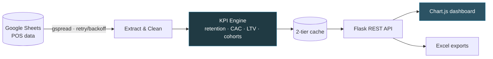
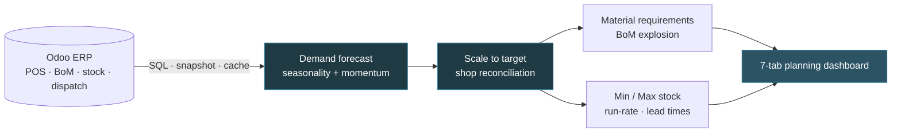

<!-- ===================== HEADER ===================== -->

  
  
  
  

---

## 👋 About Me

I'm a **Data Analyst with a Data Engineering skill set** who turns messy operational data into clear, decision-ready reporting. I work mainly in **PostgreSQL** and **Power BI**, building everything from ETL/ELT pipelines, data models, and analytical views to executive dashboards.

My foundation is quantitative: a **BSc in Actuarial Science** (KCA University), strengthened by a **Data Engineering Bootcamp** at **LuxDevHQ**. I bring a risk-and-numbers mindset to analytics, and I care about reports that are accurate, reproducible and easy for the business to use.

- 🔭 **Currently:** building retail sales and business-intelligence reporting on PostgreSQL
- 🌱 **Learning:** advanced DAX modelling, Python automation and data-pipeline design
- 💬 **Ask me about:** SQL, Power BI, data cleaning, retail and POS analytics
- ⚡ **Approach:** simple, readable solutions first, with trade-offs explained

---

## 🛠️ Tech Stack

**Databases & Querying**

**Business Intelligence & Analysis**

**Programming & Integrations**

---

## 🚀 Featured Projects

### 📊 [Customer Retention & Analytics Platform](https://github.com/lloydmwiti258-dev/customer-Retention-and-journey-Analysis) — Python · Flask · BI ⭐ *Flagship*
> A full-stack business-intelligence platform for a multi-branch retailer. It turns raw POS records in Google Sheets into a live dashboard covering **retention, CAC/LTV, regional performance, churn risk and product bundling**.

  
  
  
  
  

- **ETL pipeline** from Google Sheets: retry with exponential backoff, regex price cleaning, a shop-to-region dimension, and phone-based customer IDs
- **Retention analytics** at day, week, month, quarter, half-year and year level, plus cumulative **New vs Returning** cohorts
- **Unit economics**: CAC, LTV and period-over-period growth rates, linking marketing spend to acquisition
- **Cross-shop origin analysis** showing whether new branches win new customers or move existing ones from other shops
- **RFM-style recency segmentation** with one-click **Excel win-back lists**, plus **market-basket bundle mining**
- **Performance**: replaced an O(n×m) per-customer scan with vectorised pandas grouping; shop data lazy-loads on demand
- **Secure deployment**: environment-based secrets, Vercel/Gunicorn ready, logic checked against mock datasets

`Python` `pandas` `Flask` `REST API` `Chart.js` `Google Sheets API` `ETL` `Retention` `CAC/LTV` · 📂 [View project overview](https://github.com/lloydmwiti258-dev/customer-Retention-and-journey-Analysis)

---

### 🏭 Production Planning & Demand Forecasting — Python · PostgreSQL · Odoo 🆕 *New*
> A planning platform that turns **one monthly revenue target** into a demand forecast for every product and shop, the **raw materials to buy**, and **daily min/max stock levels** for every outlet. All of it comes from live Odoo ERP data.

  
  
  
  
  

- **Forecasting model**: each month's forecast blends the same month last year with the last three months' trend. It covers 1–12 months and is scaled to the revenue target.
- **Cold start**: new shops and products borrow growth from regional peers, then the region, then the whole portfolio, instead of being blended with a false "zero last year".
- **Hierarchical reconciliation**: bottom-up shop forecasts now sum to **exactly** the company target. Before, they overshot by ~10%.
- **MRP**: projected units are multiplied through each product's Bill of Materials to give the raw materials needed.
- **Inventory**: min/max levels come from a blend of planned and actual sales pace, plus each shop's measured dispatch lead time.
- **Data engineering**: advanced PostgreSQL (CTEs, ROLLUP, FILTER), a snapshot of closed months built from 600k+ order lines, and a cache that serves old data while it refreshes
- **Data quality**: fixed bundles counted three times, corrected pooled outlet revenue, and reconciled stock totals with the stock report

`Python` `Flask` `PostgreSQL` `Odoo` `Demand Forecasting` `MRP` `Inventory Optimisation` `Data Engineering` · 📂 [View repo](https://github.com/lloydmwiti258-dev/production-planning-forecasting)

---

### ☀️ Sunrise SQL Project — PostgreSQL
> SQL analysis project on the Sunrise dataset, covering data exploration, cleaning and business queries.

`PostgreSQL` `SQL` `Data Analysis` · 📂 [View repo](https://github.com/lloydmwiti258-dev/SQL-PROJECT)

---

### 🛒 Retail Sales Reporting Suite — PostgreSQL · Odoo POS
> A production set of SQL reports for a multi-outlet retailer running Odoo POS on PostgreSQL.

- Covers **~19 physical and online outlets** in a single, consistent reporting layer
- **ROLLUP-based subtotals** for outlet, category and grand-total views in one query
- **Canonical masterfile product ordering**, so every report lines up with the business's product list
- **Date parameters at the top of each file**, so non-technical users can rerun any period safely

`PostgreSQL` `ROLLUP` `CTEs` `Odoo` `Retail Analytics`

---

### 🚕 Ride-Hailing Analytics — SQL → Power BI
> End-to-end analysis of a real-world ride-hailing booking dataset, from dirty raw table to CEO-ready insight.

- **Cleaned a messy booking table** by fixing types, nulls, duplicates and inconsistent categories
- Built **analytical SQL views** with computed revenue columns as a single source of truth
- Connected the cleaned PostgreSQL view to **Power BI** and resolved DAX and schema-prefix issues along the way
- Delivered **CEO-facing insights** on demand, revenue and booking performance

`PostgreSQL` `SQL Views` `Power BI` `DAX` `Data Cleaning`

---

### 🚗 Car Sales Dashboard — Power BI
> Interactive Power BI report built on a car sales dataset.

- Data cleaning and shaping in **Power Query Editor**
- Debugged a custom-column formula error caused by **column type ordering in Applied Steps**
- Sales KPIs and drill-down visuals for performance tracking

`Power BI` `Power Query` `DAX`

---

### 🐍 Python ↔ Google Sheets Automation
> Lightweight pipeline that reads and writes Google Sheets from Python.

- Service-account **API setup and authentication** with `gspread`
- Read/write operations with **pandas integration** for analysis-ready DataFrames

`Python` `gspread` `pandas` `Google Sheets API`

---

## 💼 Experience

| Role | Organization | Focus |
|---|---|---|
| **Data Analyst** | Denri Africa | SQL reporting, retail sales analytics, BI |
| **Intern** | CIC Insurance | Insurance operations and data |

## 🎓 Education & Training

| Credential | Institution |
|---|---|
| **BSc Actuarial Science** | KCA University |
| **Data Engineering Bootcamp** | LuxDevHQ |

---

## 📊 GitHub Stats

---

## 🤝 Let's Work Together

I'm open to **Data Analyst, BI Analyst and Analytics Engineering** roles and collaborations. If you need clean data, reliable SQL or dashboards that leadership will use, let's talk.

